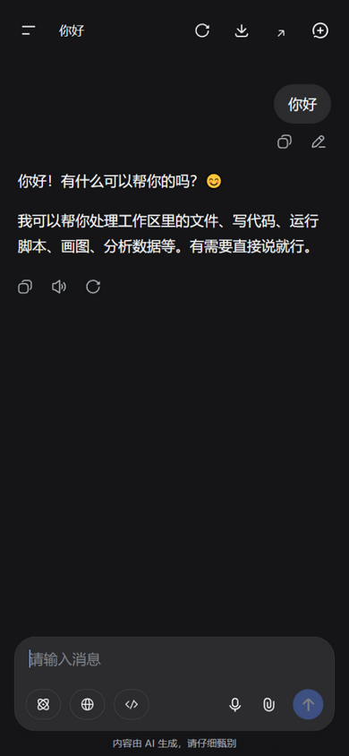
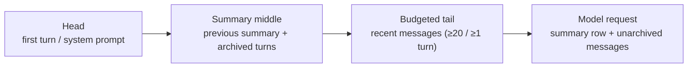
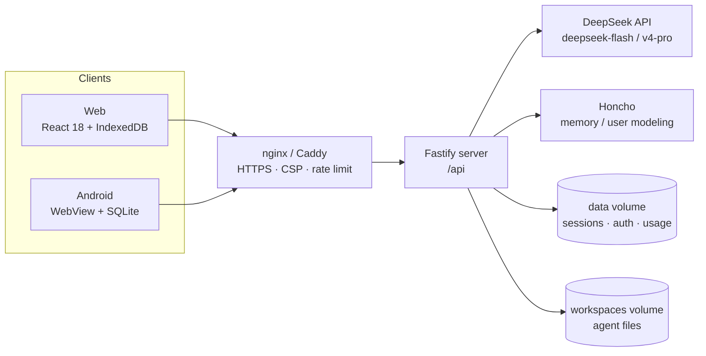
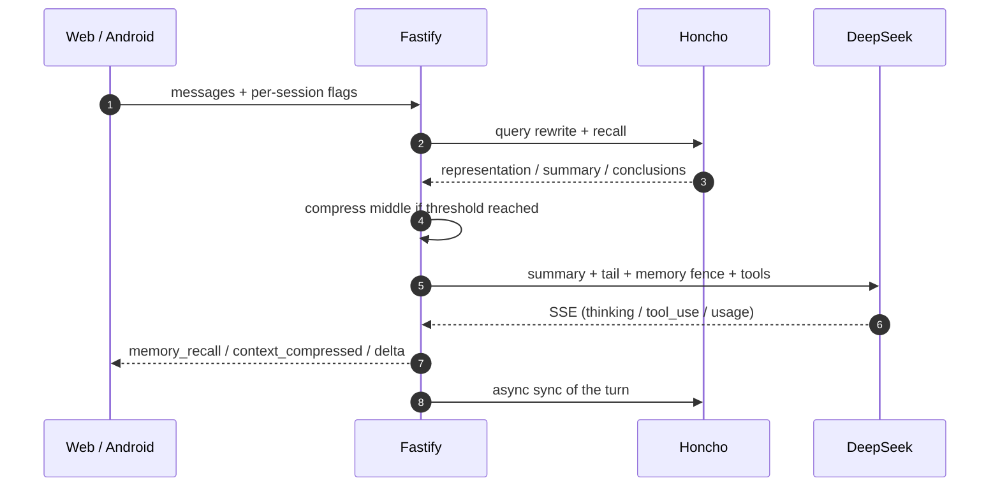
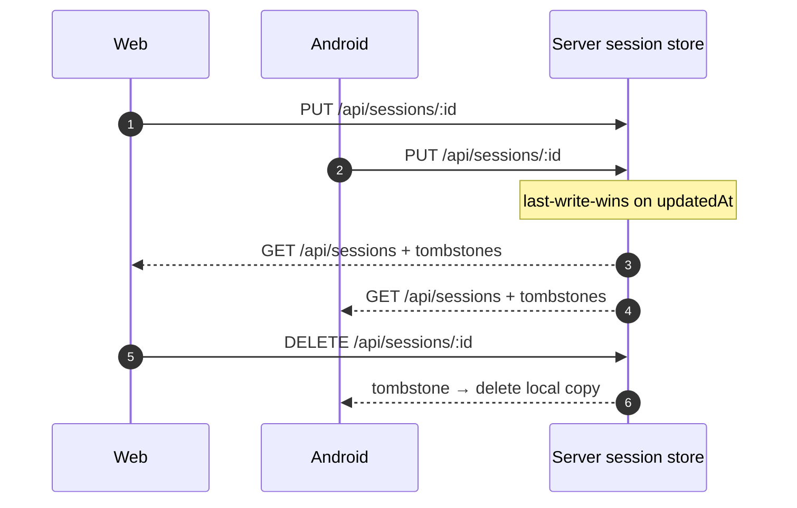

<p align="center">
  
</p>

<h1 align="center">WyDeepSeek · MyAgent</h1>

<p align="center"><strong>A self-hosted personal AI agent for the web and Android, sharing one history, memory, context and tool runtime.</strong></p>

<p align="center">
  English · <a href="README.md">简体中文</a>
</p>

<p align="center">
  
  
  
  
  
</p>

> [!IMPORTANT]
> **Unofficial project notice**
>
> This project uses **DeepSeek's goldfish logo** in its UI and documentation solely to identify the integrated model and service. WyDeepSeek (internally **MyAgent**) is an independent third-party self-hosted project and is **not an official DeepSeek product**. It is not affiliated with, endorsed by, sponsored by, or approved by DeepSeek. The DeepSeek name and logo belong to their respective owner. See [NOTICE.md](NOTICE.md).

---

WyDeepSeek (internally **MyAgent**) is a **single-user, self-hosted agent workspace**, not another chat wrapper:

- The **web app** owns the full editing, branching, import/export and workspace experience.
- **Android is a client of the web backend**: requests normally go `phone → your server → DeepSeek`; the phone does not store the server-side DeepSeek key.
- The **server** handles session sync, long-term memory, context compression, the agent tool loop, usage accounting and auth.
- **Both clients share one conversation history**; continue on one device and the other sees the same messages, groups, archive state and compression metadata.

## Contents

- [Screenshots](#screenshots)
- [Features](#features)
- [Architecture](#architecture)
- [Ported features and provenance](#ported-features-and-provenance)
- [Quick start](#quick-start)
- [Configuration](#configuration)
- [Data and sync](#data-and-sync)
- [API overview](#api-overview)
- [Project layout](#project-layout)
- [Security](#security)
- [Tests](#tests)
- [License and acknowledgements](#license-and-acknowledgements)

## Screenshots

| Desktop: agent timeline and delivered files | Mobile: WebView responsive layout for the same conversation |
| :---: | :---: |
|  |  |

| Usage: balance, tokens, speed, 7-day chart | Memory & context: service status, recall, compression |
| :---: | :---: |
|  |  |

> Dark theme; the balance value is masked in the screenshot.

## Features

### Chat and content

- Multiple conversations, auto titles, rename, pin, groups, archive, duplicate.
- Streaming replies, deep thinking, smart search, link reading and citations; stop, regenerate, continue.
- Edit a user message, switch message branches, rewind to a message and ask again.
- Markdown, syntax highlighting, KaTeX math and Mermaid diagrams.
- Image/file attachments, drag-and-drop and paste, voice input, read-aloud.
- Chinese/English UI, light/dark themes, desktop and mobile layouts.
- Export Markdown / PDF / HTML; import a single Markdown / HTML conversation.

### Long-term memory (ported from Hermes)

- **Self-retrieval**: query rewrite on every turn, recall of user representation, conclusions and session summary from Honcho, injected inside a `<memory-context>` fence.
- **Recall panel**: “N memory sections recalled” above the reply, expandable to inspect the injected context.
- **Memory browser**: user representation, peer card, AI self-representation and Honcho conclusions; individual conclusions can be deleted.
- **Per-session switches**: retrieval, recall details and memory read/write can override server defaults.
- **Async writes**: turn sync runs after the reply and never blocks the stream; failures are logged only.

### Context compression (ported from Hermes)

- Head-protected + summarized middle + budgeted tail, triggered near the threshold.
- Default threshold: `50% × (context window − max output)`, 64K floor; tail budget `min(25K, ctx×2.5%)`.
- Iterative summaries: previous summary + new turns; deterministic fallback summary and cooldown on failure.
- **No history loss**: messages stay visible; only the model projection skips archived turns. A “context compressed (N turns)” divider exposes the summary.
- Header ring shows current context usage against a 128K window (yellow ≥70%, red ≥90%); manual “compress now” is available.



> Head and tail are preserved verbatim; only the middle is replaced by a structured summary, and the next compression iterates on the previous summary.

### Advanced retrieval (optional)

- **Conversation index**: a per-conversation SQLite FTS index over message history; the agent can search earlier turns, including compressed ones.
- **Reference index**: a chunked Markdown index over the current conversation's `references/`; search returns file path and line range, then `read_file` reads it back with `offset`/`limit`.
- Two independent switches under Settings → Memory & context; Agent mode is required.
- **Conversation isolation**: index files are keyed by sessionId hash and tools are bound to the current session; no cross-conversation queries.
- Reference files are no longer rejected at 2MB; reads are chunked so large files never enter context in one piece.

### Agent mode (server-side)

- Per-session toggle; each agent session gets an isolated workspace.
- Tool loop: `list_files`, `read_file`, `write_file`, `delete_file`, `run_python`, `run_script`.
- Python runs in the server workspace with numpy/matplotlib/pandas/requests preinstalled; matplotlib uses a headless backend.
- Delivered-file cards: text/image preview and download; the web client also has a workspace file tree.
- Web-only SSH remote workspace (password or private key, session-scoped, never synced).
- Tool calls render as a collapsible timeline, expanded while running and collapsed when done.

### Multi-device sync

- The server is the meeting point; both clients sync to `/app/data/sessions/`.
- Pull on startup, focus and every 30 seconds; push about one second after a local save.
- Titles, messages, branches, compression state, groups, archive, pin and per-session switches all sync.
- Deletes use server tombstones; offline deletes are replayed when the network returns.
- Attachment bytes are not synced across devices; agent artifacts live in the server workspace and are visible to both.

### Usage and cost

- Settings → **Usage**: balance, total tokens, input/output/cache reads, requests, generation speed (tokens/s).
- 7-day token bar chart.
- Balance from DeepSeek's official `GET /user/balance`, cached for 30 seconds with manual refresh.
- Average cost estimated from balance delta ÷ token delta; shown after roughly 20K tokens because billing granularity is coarse.

## Architecture







## Ported features and provenance

The web UI grew out of DeepSeek chat-demo. The memory and context features are **behavioral ports of Hermes Agent**, rewritten in TypeScript for a single-user, stateless-proxy architecture. The porting baseline is the `NousResearch/hermes-agent` main branch as of 2026-11; upstream continues to evolve, so the file paths in this repo's code comments are the authoritative mapping. Claude Code is a **conceptual reference** for the agent tool model.

| Capability | Upstream source | This repo | Porting notes |
| --- | --- | --- | --- |
| Self-retrieval / memory recall | Hermes `agent/memory_provider.py`, `agent/memory_context.py`, `plugins/memory/query_rewrite.py`, `session_rules/turns.py` — [NousResearch/hermes-agent](https://github.com/NousResearch/hermes-agent) | `server/src/memory/{honcho,queryRewrite,trivial,fence}.ts` | Python → TypeScript behavioral port: trivial-prompt filter, query rewrite regexes, `<memory-context>` fence, bullet dedupe and cadence backoff; multi-provider/cron removed for a single user |
| Context compression | Hermes `agent/context_compressor.py` ([pinned link](https://github.com/NousResearch/hermes-agent/blob/b98c388a/agent/context_compressor.py)) | `server/src/compression/{window,prompt,compress,tokens}.ts` | Ported the three-window plan, 50% threshold, 64K floor, iterative summaries, `[REDACTED]` secret red-line, static fallback and failure cooldown; compression state lives in session metadata + server memory |
| Long-conversation management | Hermes archive/token-ledger semantics | `src/services/chat/usage.ts`, `server/src/usage.ts`, message divider | Full history remains visible; the model projection skips archived turns; usage is accumulated per turn and compressed-round count syncs |
| Conversation / reference indexes | Goose `crates/goose/src/session/chat_history_search.rs` (message keyword search), `services/ask-ai-bot/utils/ai/chunk-markdown.ts` (Markdown chunks), `services/ask-ai-bot/utils/ai/tools/codebase-search.ts` (path/line snippets) | `server/src/indexing/{store,chunk}.ts`, `server/src/agent/tools.ts`, `server/src/agent/workspace.ts` | Reimplemented with Node's built-in SQLite FTS5, one index per session; added `search_conversation` / `search_references` tools and `read_file` offset/limit chunking |
| Honcho memory backend | [Plastic Labs Honcho](https://github.com/plastic-labs/honcho), `hermes-plugin-honcho` | `server/src/memory/honcho.ts`, `server/src/honcho/api.ts`, Compose profile | Session/peer modeling, context + dialectic layers, batched messages and conclusions; a lightweight client aligned with Honcho v3 REST routes; single user, embeddings off by default |
| Rewind | Hermes `/rewind` semantics | `src/services/chat/store.ts`, `mobile/src/services/chat/store.ts` | Truncate everything after the target message and ask again; web and Android behave the same |
| Agent tool loop | Claude Code QueryEngine `tool_use / tool_result` and session-scoped cwd — [anthropics/claude-code](https://github.com/anthropics/claude-code), concept only | `server/src/agent/{loop,tools,workspace,ssh}.ts` | Not a source port: tool protocol, workspace prefix checks, Python isolation and SSH/SFTP rewritten in TypeScript; at most 10 iterations |
| Web UI base | [DeepSeek chat-demo](https://github.com/deepseek-ai/chat-demo) (MIT) | `src/` | Kept the chat UI, Markdown/KaTeX/Mermaid, branches and import/export; added server proxy, memory, compression, agent, usage and auth |
| Android client | [deepseek-app-replica](https://github.com/LiJiaHua1024/deepseek-app-replica) (GPL-3.0) | `mobile/` | Kept its UI and local SQLite store; added server mode, cross-device sync, agent/memory/compression switches, context ring, usage, workspace and export |
| Usage / balance / cost | Original to this repo; DeepSeek `/user/balance` | `server/src/usage.ts`, `src/components/settings/UsageSettings.tsx`, `mobile/src/components/usage/UsagePanel.tsx` | Aggregates usage snapshots, persists balance samples and estimates cost from balance deltas |
| Security hardening | Original; audited with ARTEX 2.2.0 (authorized self-test) | `server/src/auth.ts`, `routes/auth.ts`, `agent/ssh.ts`, `rateLimit.ts`, `sessions.ts` | scrypt password, HMAC cookie/Bearer, login/chat rate limits, CSRF origin checks, SSRF blocking, logout revocation, generic errors; see [SECURITY.md](SECURITY.md) |

**Porting boundaries**

- Hermes is ported at the **behavior level**, not line-by-line: thresholds, prompt structure, dedupe/cooldown/fallback semantics are preserved; multi-user, cron and provider discovery are intentionally omitted.
- Claude Code is a **conceptual reference**; no source code was copied.
- The Android UI is a **GPL-3.0 derivative** of deepseek-app-replica; the root MIT license covers the web/server code, not the mobile UI.
- Honcho is optional: without the `honcho` profile, chat and compression still work; the memory panel simply reports “not connected”.

## Quick start

### Docker (recommended)

Prerequisites: Docker Desktop with Compose, and network access to the DeepSeek API.

```sh
git clone <your-repo> MyAgent
cd MyAgent

cat > .env <<'EOF'
DEEPSEEK_API_KEY=sk-your-key
ACCESS_PASSWORD=a-strong-password-at-least-16-chars
REQUIRE_AUTH=true
EOF

docker compose up -d --build                      # dev web + server
docker compose --profile honcho up -d --build     # memory backend (optional)
docker compose --profile prod up -d --build       # nginx production preview
```

| Entry | URL | Notes |
| --- | --- | --- |
| Dev web | http://localhost:8090 | rspack dev server with HMR |
| Prod preview | http://localhost:8080 | nginx hosting `dist/` + `/api` proxy |
| Server | http://127.0.0.1:3000/api/health | local-only debug port |
| Honcho | internal Compose network | api / deriver / db / redis |

`ACCESS_PASSWORD` is used only on first boot when no password has been set in the UI; afterwards `data/auth.json` holds the scrypt hash.

### Local development

Requires Node.js 22.12+ and pnpm. Run web and server separately:

```sh
pnpm install
pnpm dev                 # web on :8090

cd server
pnpm install
pnpm dev                 # server on :3000
```

### Android

The Android app is a WebView client; see **[mobile/README-MYAGENT.md](mobile/README-MYAGENT.md)** for build and install steps.

```sh
cd mobile/android
./gradlew :app:assembleDebug -x buildWeb
# output: mobile/android/app/build/outputs/apk/debug/app-debug.apk
```

Text chat, memory, compression and agent mode do not need a key on the phone. Image/file attachments still use the DeepSeek Files API and require a user-provided DeepSeek key inside the app.

## Configuration

Root `.env` (read by Compose):

| Variable | Default | Purpose |
| --- | --- | --- |
| `DEEPSEEK_API_KEY` | empty | Server-side fallback key; also used by compression, query rewrite, Honcho deriver, usage/balance |
| `ACCESS_PASSWORD` | empty | First-boot access password (10+ chars; 16+ recommended) |
| `REQUIRE_AUTH` | `false` | Reject all business APIs if no password is set; required for public deployments |
| `PUBLIC_DOMAIN` | empty | Domain for Caddy automatic HTTPS |
| `ACME_EMAIL` | empty | Let's Encrypt email |
| `PROD_BIND` | `0.0.0.0` | Production bind address; use `127.0.0.1` behind Caddy |
| `TRUST_PROXY` | `true` in Compose | Only enable when the server is reachable solely through nginx/Caddy that overwrite `X-Forwarded-*` |
| `SSH_ALLOW_PRIVATE_HOSTS` | `false` | Allow SSH to private/loopback addresses; off by default to block SSRF |
| `CHAT_RATE_LIMIT_PER_MINUTE` | `30` | Per-client chat/compression request limit |
| `ALLOWED_MODELS` | `deepseek-flash,deepseek-v4-pro` | Model allowlist |
| `CORS_ORIGINS` | mobile WebView + local preview | Additional allowed origins |
| `HONCHO_BASE_URL` / `HONCHO_API_KEY` | empty / `local` | Self-hosted Honcho endpoint and key |
| `DATA_ENCRYPTION_KEY` | empty | Optional 32-byte master key (64-char hex / base64); takes precedence over the key file |
| `DATA_ENCRYPTION_KEY_FILE` | `/app/secrets/encryption.key` | Key file path; generated on first boot if no env key is set |
| `EXEC_TMP_ROOT` | `/run/myagent-exec` | Decrypted tmpfs for Python execution; must be a memory-backed filesystem |

See [server/.env.example](server/.env.example) and [SECURITY.md](SECURITY.md) for the full list.

## Data and sync

| Data | Location | Cross-device |
| --- | --- | --- |
| Web conversations, drafts, attachment originals | IndexedDB + localStorage | Conversations sync; attachment bytes do not |
| Android conversations | local SQLite + metadata sidecar | Yes, via server |
| Server conversations / summaries | `myagent_data` volume `/app/data/sessions/` (AES-256-GCM ciphertext) | Shared by both clients |
| References / workspace | `myagent_workspaces` volume `/app/workspaces/` (ciphertext) | Shared; both clients can view |
| Search indexes | `myagent_data` volume `/app/data/indexes/` (ciphertext; decrypted in memory for queries) | Server side |
| Encryption key | `myagent_secrets` volume `/app/secrets/encryption.key` | Server only |
| Password hash / session secret | `myagent_data` volume (session secret encrypted) | Server only |
| Usage samples | `myagent_data` volume `usage-state.json` (ciphertext) | Both clients read the same stats |
| Honcho memory | `myagent_honcho_pgdata` / `myagent_honcho_redis` volumes | Server side; **still plaintext, requires volume encryption** |

Server conversations, compression summaries, references, agent workspace files and SQLite FTS indexes are encrypted at rest with **AES-256-GCM**; indexes are decrypted into process memory for queries, and Python execution uses a decrypted tmpfs plus an unprivileged UID. The key lives in a separate volume and is generated on first boot; **losing it makes the data unrecoverable**, so back up `myagent_secrets`. Browser IndexedDB, Android SQLite and Honcho's Postgres/Redis are outside this application-layer encryption.

Sync is **last-write-wins** on `updatedAt`; deletes write tombstones, and clients remove local copies and clean up workspaces. The server validates session shape (messages array, finite timestamps, nesting ≤200, ≤20k messages) and strips `ssh` credentials.

## API overview

| Method | Path | Purpose |
| --- | --- | --- |
| `POST` | `/api/chat` | Web SSE chat (memory, compression, agent, usage) |
| `POST` | `/api/mobile/messages` | Android chat through the same pipeline |
| `POST` | `/api/chat/complete` | Turn completion; async memory write |
| `POST` | `/api/compress` | Manual context compression |
| `GET/PUT/DELETE` | `/api/sessions`, `/api/sessions/:id` | List / read / sync / delete conversations |
| `GET` | `/api/usage` | Tokens, speed, balance and cost |
| `GET/POST/DELETE` | `/api/agent/*` | Workspace tree/files, SSH test, references |
| `GET/DELETE` | `/api/memory/*` | Memory status and conclusions |
| `POST` | `/api/auth/login`, `/api/auth/logout`, `/api/auth/password` | Login, logout/revocation, password change |
| `POST` | `/api/export/*` | Markdown / PDF / HTML export |

All business APIs require a cookie or `Authorization: Bearer`; mobile login uses `x-myagent-client: mobile` to receive a Bearer token.

## Project layout

```text
.
├── src/                 # web app (React 18 + rspack)
├── server/              # Fastify + TypeScript backend
│   └── src/
│       ├── agent/       # tool loop, workspace, SSH
│       ├── compression/ # Hermes compression port
│       ├── memory/      # Hermes / Honcho memory port
│       ├── routes/      # chat / sessions / auth / usage / export
│       ├── sessions.ts  # session store, tombstones, validation
│       └── usage.ts     # tokens / balance / cost
├── mobile/              # Android WebView client (GPL-3.0 derivative)
├── docker/              # nginx / Caddy configuration
├── docs/images/         # README screenshots and logo
├── compose.yaml         # web / server / honcho / prod / public
├── SECURITY.md          # security assessment and public checklist
├── NOTICE.md            # trademark and unofficial-project notice
└── DOCKER.md            # Docker details
```

## Security

- Single-user access password: scrypt hash, HMAC-signed cookie/Bearer, login rate limit, secret rotation on password change, logout revocation.
- Public deployment: `REQUIRE_AUTH=true`, HTTPS via Caddy, expose only 80/443, never publish 8090/3000.
- API hardening: CORS allowlist, CSRF origin checks, chat/compression/SSH rate limits, SSRF blocking, generic errors, session shape validation.
- **Encryption at rest**: conversations, references, workspace files and search indexes are stored as AES-256-GCM ciphertext with a separately stored key. Existing plaintext files are re-encrypted in place on upgrade. Losing the key makes data unrecoverable; see [DOCKER.md](DOCKER.md).
- Agent mode is **server-side code execution**: Python now runs as unprivileged UID 10001 and cannot read the encryption key, but the server process itself is still root. Use it only for yourself; split it into a separate sandbox runner for high-security public deployments.
- An authorized ARTEX 2.2.0 self-test in 2026-11 found and fixed process crashes, XFF rate-limit bypass, SSH SSRF, CSRF/Origin issues and session validation gaps; see [SECURITY.md](SECURITY.md).

## Tests

```sh
pnpm type && pnpm lint && pnpm build
cd server && pnpm type && pnpm test && pnpm lint
```

## License and acknowledgements

- **Web / server**: MIT, see [LICENSE](LICENSE).
- **Android**: GPL-3.0-or-later, derived from [deepseek-app-replica](https://github.com/LiJiaHua1024/deepseek-app-replica).
- UI base: [DeepSeek chat-demo](https://github.com/deepseek-ai/chat-demo) (MIT).
- Memory and compression: [NousResearch/hermes-agent](https://github.com/NousResearch/hermes-agent); Honcho plugin: [plastic-labs/honcho](https://github.com/plastic-labs/honcho/tree/main/hermes-plugin-honcho).
- Agent tool concepts: [anthropics/claude-code](https://github.com/anthropics/claude-code).
- Models: DeepSeek (`deepseek-flash` / `deepseek-v4-pro`).
- **Trademark notice**: the DeepSeek goldfish logo is used for identification only and does not imply an official DeepSeek product; see [NOTICE.md](NOTICE.md).

---

<p align="center"><sub>WyDeepSeek · run your personal agent on your own server</sub></p>
